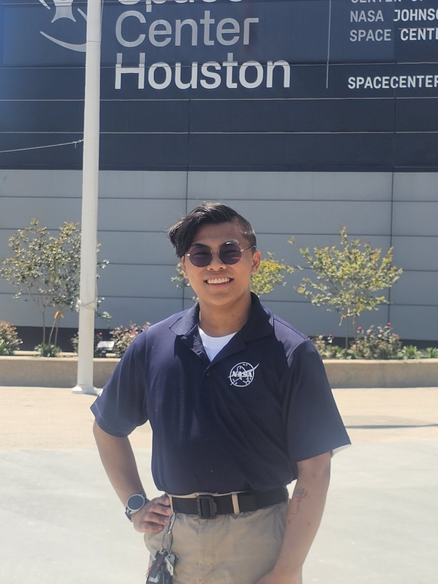

  
  

    
      

      <a href="mailto:outreach@jodavey.net">outreach@jodavey.net</a>
      

  

  

    
**Hi there! My name is Jo, and I like sending things up into space.** I am an undergraduate Physics student with an interest in high-altitude instrumentation and atmospheric sciences. My most recent project involved measuring how ultraviolet and infrared radiation changes during a total solar eclipse.

Currently, I am an Administrative Assistant at Central Washington University, where I proudly support students, staff, and faculty across the natural and social sciences.

In my spare time, I enjoy life with my wife, child, and three cats. I love learning about the arts and humanities, as well as the social and natural sciences. I fill my free time with road and gravel cycling, watercolor painting, Chinese calligraphy, and knitting/sewing. I'd love a chance to practice one of the four languages that I know.

  

