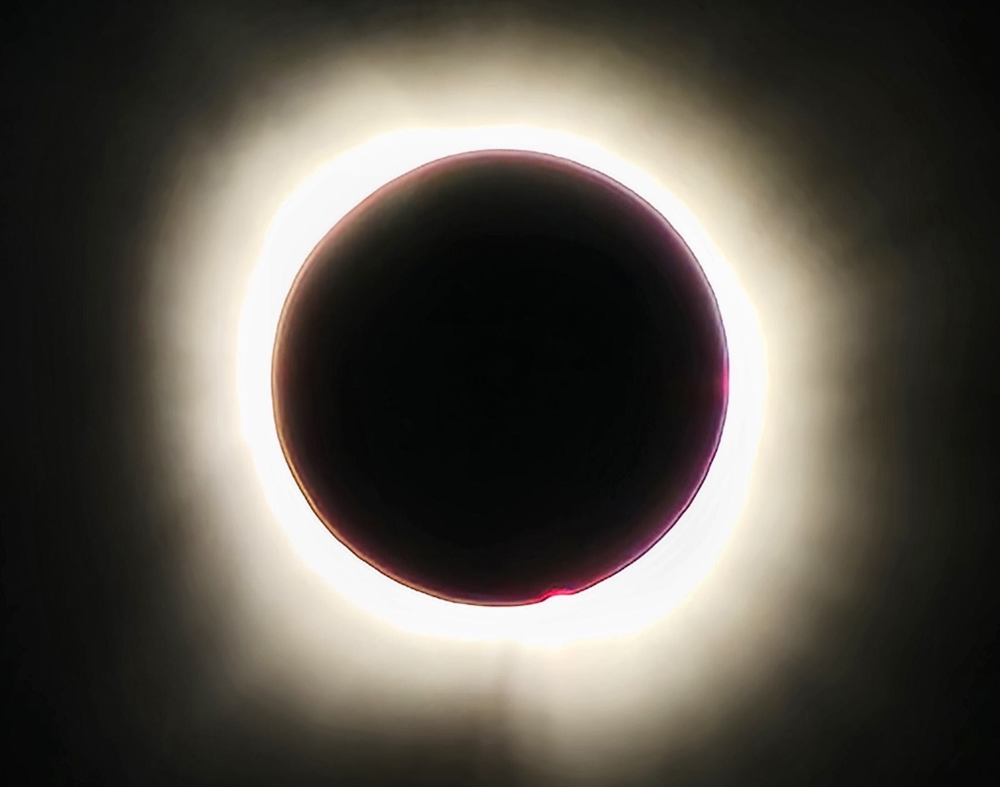

  
  

    <h1>Projects</h1>
    

  
 

<!-- Project rows -->

  

  
  

  

  <h2><a href="/projects/uv-ir-sensors/">Low-cost eclipse UV/IR telemetry</a></h2>
    
  
Developed and deployed payload telemetry to measure high-altitude changes in UV and IR radiation during a total solar eclipse.
      

